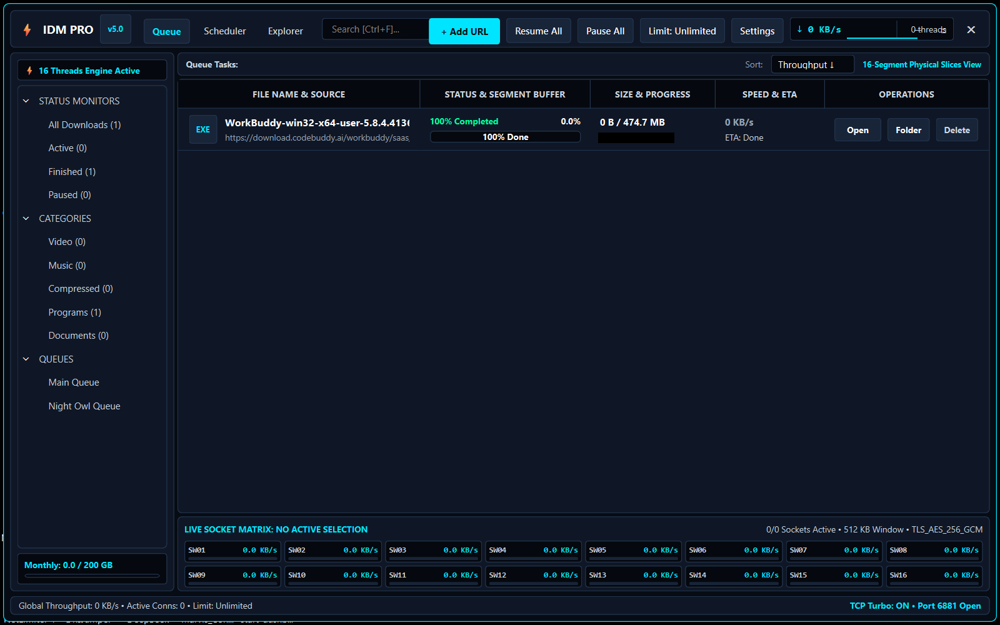
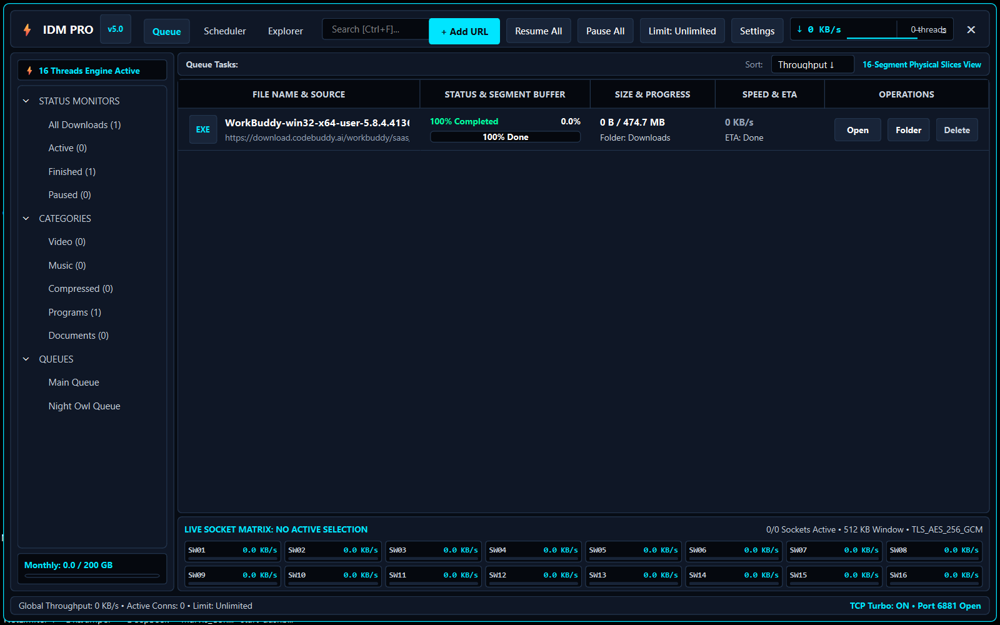
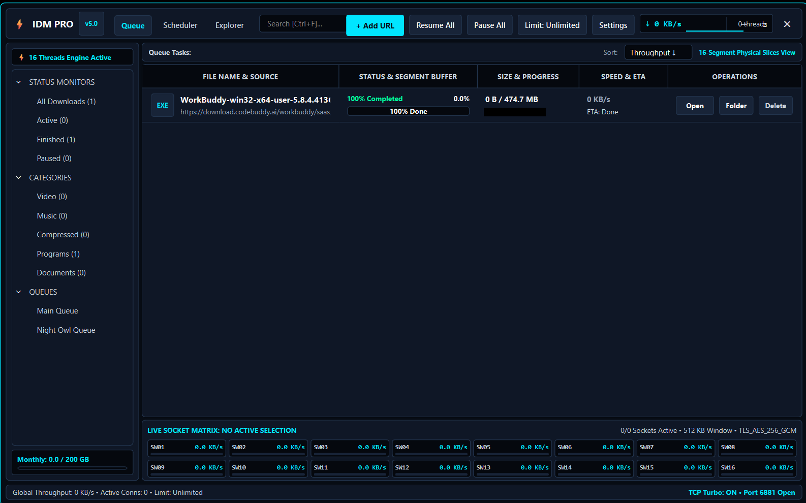

# IDMClone (REA_IDM)

<div align="center">


[](https://letmese-portfolio.web.app)
[](https://wa.me/923171616345?text=Hi%20letmese%2C%20I%20am%20interested%20in%20your%20IDMClone%20project.)

### *Modern Multi-Threaded Accelerated Download Manager for Windows*

</div>

---

## 📖 Overview

**IDMClone** is a high-performance Internet Download Manager engineered for Windows. Built with **Python 3.11**, **PySide6 (Qt 6)**, and an asynchronous multi-connection socket architecture, it saturates available bandwidth by partitioning large files into dynamic ranges and streaming segments concurrently.

---

## 📸 Desktop Application Preview

<div align="center">
  
</div>

<br/>

<div align="center">
  
  
</div>

---

| Capability | Module | Details |
| :--- | :--- | :--- |
| **Segmented HTTP/HTTPS Streaming** | `app/engine/downloader.py` | Multi-connection chunk streaming (Range 206) with dynamic socket allocation. |
| **Fault-Tolerant Resuming** | `app/engine/downloader.py` | Crash-safe chunk saving with `.part` state files; seamlessly resumes broken connections. |
| **Speed Limiter (Token Bucket)** | `app/engine/downloader.py` | Precision KB/s throughput bandwidth throttling. |
| **Proxy & Tor Integration** | `app/engine/downloader.py` | SOCKS4/5, HTTP/HTTPS proxies, proxy authentication, and Tor onion routing presets. |
| **Smart Scheduler & Off-Peak Queue** | `app/core/scheduler.py` | Automated time-window scheduling and Night Owl off-peak queuing (02:00 AM). |
| **HLS Stream Grabber** | `app/grabber/hls.py` | Real-time `.m3u8` video stream parser and segment merger. |
| **Obsidian Cyber Mica UI** | `app/ui/main_window.py` | Modern dark Fluent styling with live throughput sparkline HUD and 16-socket matrix visualizer. |
| **Dynamic Slices Range Buffer** | `app/ui/widgets/segmented_bar.py` | Live visual representation of chunk download progress across segments. |

---

## 🛠️ Tech Stack

- **Core Engine:** Python 3.11 (`requests`, `urllib3`, `asyncio`, custom chunked I/O)
- **GUI Framework:** PySide6 (Qt 6 for Python)
- **Styling:** Custom Mica & Obsidian Cyber theme engine
- **Packaging:** PyInstaller configuration (`IDMPro.spec`)

---

## 🚀 Running from Source

### Prerequisites
- Python 3.11 or higher
- Git

### Installation
```bash
git clone https://github.com/letmese/IDMClone.git
cd IDMClone

# Install dependencies
pip install -r requirements.txt

# Launch application
python app/main.py
```

Or run directly via `run.bat` on Windows.

---

## 📦 Pre-Built Downloads

To download the ready-to-run Windows standalone executable, check the releases:
* **[GitHub Releases](https://github.com/letmese/IDMClone/releases)**

---

## 👨‍💻 Developer & Inquiries

Developed and maintained by **letmese**.

* **Website / Portfolio:** [**letmese-portfolio.web.app**](https://letmese-portfolio.web.app)
* **GitHub Profile:** [@letmese](https://github.com/letmese)
* **Location:** Lahore, Pakistan (Available for projects & consulting worldwide)
* **WhatsApp Direct:** [**+92 317 1616345**](https://wa.me/923171616345?text=Hi%20letmese%2C%20I%20am%20interested%20in%20your%20IDMClone%20project.)

---

## 📄 License

This project is licensed under the [MIT License](LICENSE).
